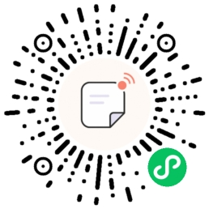
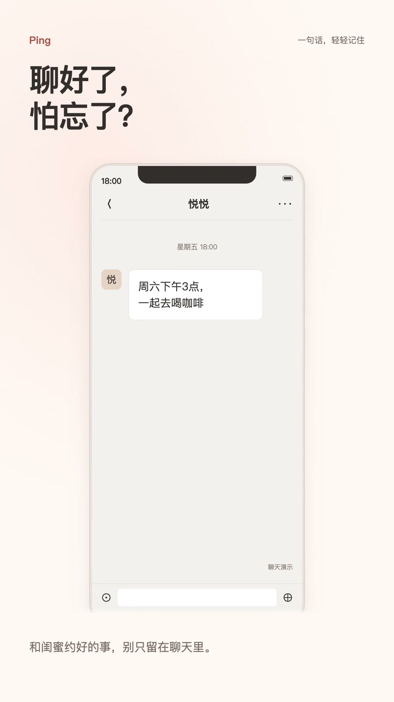

# Ping

一句话，轻轻记住。Ping 是基于微信云开发的自然语言提醒小程序：输入「周六下午三点喝咖啡，提前十分钟提醒」，确认解析结果后保存，让约定有处安放。

## 扫码体验

使用微信扫描下方小程序码，打开 Ping。

## 30 秒宣传视频

[▶ 观看完整视频](https://github.com/smallmarker/ping/blob/main/docs/media/ping-promo-30s.mp4) · [下载 MP4](https://github.com/smallmarker/ping/raw/refs/heads/main/docs/media/ping-promo-30s.mp4)

30 秒 · 1080 × 1920 竖屏 · 含音乐与交互音效。视频中的聊天和通知画面为演示；实际接收提醒需允许订阅消息，且由服务端成功发送。

## 功能

- **自然语言创建提醒**：解析时间、事项与提前提醒时间，保存前可核对和修改。
- **提醒管理**：查看、编辑、删除提醒，已通知的事项归入历史记录。
- **微信订阅消息**：授权后，通过云函数定时发送到期提醒。
- **主动读取剪贴板**：点击「使用剪贴板」才读取内容，点击 Ping 后才上传解析。

当前采用确定性规则解析，未接入外部 AI 模型。

## 快速开始

1. 用微信开发者工具导入此目录，创建或选择一个云开发环境，并在 `miniprogram/app.ts` 中设置 `env`。
2. 在云开发数据库创建 `reminders`、`feedback` 集合。客户端只通过校验 OpenID 的云函数访问；生产环境应禁止客户端直接读写集合，避免客户端改写通知状态或读取他人反馈。安全规则需在后台单独核验，不由代码部署自动设置。
3. 逐个右键部署 `cloudfunctions` 下的云函数（包括新增的 `completeReminder`），并在部署时安装依赖。
4. 为 `sendReminder` 配置环境变量 `SUBSCRIBE_TEMPLATE_ID=HtgkJMyjVsj_7LwYSBDY5KtpseqrA8hh5cTBHuEojTI`。定时触发器定义在 `cloudfunctions/sendReminder/config.json`，每分钟运行一次；在微信开发者工具中右键该 `config.json`，选择「上传触发器」。发送函数通过微信运行时注入的 `getWXContext().SOURCE === 'wx_trigger'`、事件类型和触发器名称校验调用来源，不接受客户端自报来源或普通 SCF 定时调用，避免无微信凭证的调用抢先将提醒标记发送失败。已核对模板字段为 `thing5`（日程标题）和 `date4`（日程时间）。发送函数只处理到期不超过 5 分钟的提醒，不补发很久以前的通知。
5. 在数据库核验查询索引：按 OpenID + 状态 + 创建时间/提醒时间 + `_id` 的列表游标组合（排序方向与查询一致），已完成记录按 `completedAt` 排序；通知扫描需要 `status + notifyStatus + notifyAt`、租约恢复需要 `notifyStatus + notifyLockAt`；反馈清理需要 `expiresAt`。按控制台的实际查询提示建立复合索引，不应仅照搬旧版单时间字段索引。
6. 新反馈写入 180 天后的 `expiresAt`。部署 `privacyMaintenance` 后，在开发者工具右键其 `config.json` 上传微信定时器 `pingFeedbackRetentionDaily`（每天 03:00）。仅带 `expiresAt` 的到期反馈会被清理，历史反馈及提醒不会批量清理。上传函数代码不代表触发器已上传，必须单独核验。

`parseReminder` 目前包含确定性的规则解析与严格的输入/输出校验，便于开发调试。生产接入模型时，应继续保留 JSON Schema、时区和日期复核；模型输出永远不能直接写入数据库。

## 目录

- `miniprogram/`：小程序页面、服务封装、类型和工具函数
- `cloudfunctions/`：解析、提醒 CRUD 与订阅消息发送服务

## 订阅消息部署核验

- 免费体验版适配（2026-10-14）：保留 3 秒超时。每分钟调度最多发送一条，发送主路径为一次查询、一次条件领取、一次微信请求、一次结果回写。2.2 秒软工作预算留出退出余量；模块加载耗时也扣入首次预算。时间不足时不启动发送，未发送的领取释放给下一轮；网络结果未知不会盲目重发。软预算不能取消数据库请求或消除平台冷启动/网络硬超时，需要真机与日志验证。
- 没有可发送提醒的空闲轮次，最多维护一条旧租约/过期状态；确定未发的旧 claimed 恢复后在下一次轮次发送。原每分钟触发器不变。容量适合低流量试用，同一分钟多条会排队，超过原 5 分钟有效窗口可能错过，不适合高并发或保证准点的场景。
- 反馈清理保留已上传的每日触发器，每次最多 10 条到期新反馈，仅使用一次查询和一次带 ID 白名单、到期条件的批量删除；不足预算则延后到下次。没有 expiresAt 的旧反馈不清理。每日超过 10 条到期数据会积压，后续应按真实流量调整批次/频率并同步核对保留期，不能视为精确到秒的 180 天删除保证。

- `sendReminder/config.json` 必须声明 `permissions.openapi: ["subscribeMessage.send"]`；通过微信开发者工具部署函数，并右键该文件「上传触发器」，不要只在腾讯云网页创建普通定时器。微信云调用依赖有效的微信侧调用凭证。
- 日志中的平台 `200` 仅代表函数执行成功，不代表消息送达。检查 `sendReminder result` 的扫描、成功、失败数量，并核对提醒文档的 `notifyStatus` 和 `notifyLastError`。
- `Invalid wxCloudApiToken` 属于微信云调用凭证问题，不能靠用户重复授权解决。修复后新增未来 3–5 分钟的提醒进行真机验证；已失败且过期的记录不补发。

## 提醒列表同步规则

- 创建、编辑、完成和删除只有在云函数返回成功后才更新共享的会话数据；失败操作不会显示为已保存。
- 首页每次显示时，先应用共享数据，立即更新事项、日期分组和已完成数量，再请求云端核对；支持下拉刷新和失败重试。
- 读取使用请求序号防止较早发起的请求覆盖较新的结果。尚未被后续读取核实的成功写入会合并到列表，避免旧列表响应让新事项消失、修改回退或已删除事项重新出现。
- 非删除写入在后续请求返回匹配记录后交还云端数据；删除标记保留到本次应用会话结束。缓存不落盘，重新启动后从云端加载。
- 保存期间禁止重复提交，网络失败重试沿用同一请求 ID，配合服务端幂等处理避免重复创建。
- 单页最多 50 条，通过稳定游标继续读取，所有页成功后才替换共享缓存；详情按 ID 独立查询，不依赖提醒册分页成功。统计由云端计数获取。

## 隐私与删除

- 隐私政策在「我的 → 隐私政策」可访问；运营者张龙，公开联系微信 smallmarker。提审前仍需核对公众平台隐私保护指引、实际调用清单和新用户授权流程。
- 不在首页显示或返回时读取剪贴板；仅主动点击「使用剪贴板」读取本地预览，点击 Ping 后才上传解析。
- 未来删除立即移除提醒正文，只保留必要标识与删除状态；不清理历史数据。旧请求无法恢复已删除提醒。反馈到期任务必须部署并核验，不能仅凭政策正文视为生效。
- 通知租约区分未调用微信的 claimed 与结果可能未知的 dispatching。仅确定未发送的超时任务可重试；未知结果不盲目重发，详情展示真实通知状态。过期与通知失败不等于事项完成。
- 所有函数锁定 wx-server-sdk 4.0.2，并保存依赖锁文件；通过 IDE 部署时仍须核验实际运行配置、模板变量与定时器。

回归测试：`node --test tests/*.test.js`，覆盖成功写入后的即时同步、旧响应竞争、刷新失败和保存重试。
